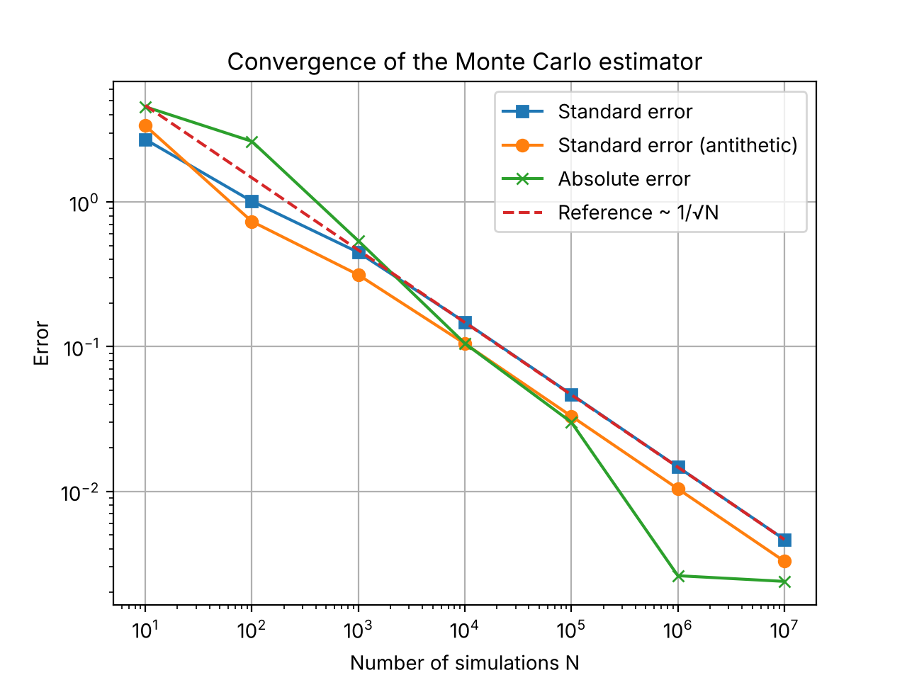

# Monte Carlo Option Pricing vs. Black-Scholes

A Python implementation that prices European options with Monte Carlo simulation and checks the results against the closed-form Black-Scholes formula.

## Overview

I built this project to understand how Monte Carlo pricing works and how accurate it is. The stock price is simulated under the risk-neutral measure, the discounted payoffs are averaged, and the result is compared with the exact Black-Scholes price. The project also looks at how fast the estimate converges, how much variance reduction helps, and how to estimate the Greeks by simulation.

All results use the parameters $S_0 = 100$, $K = 100$, $r = 0.05$, $\sigma = 0.2$, $T = 1$.

## Features

- Black-Scholes prices for European calls and puts
- Monte Carlo prices with standard error and 95% confidence intervals
- Coverage test for the confidence interval (1000 repeated simulations)
- Convergence study with the empirical rate in a log-log plot
- Put-call parity check
- Antithetic variates for variance reduction
- Delta and Vega: closed-form, finite differences, and the pathwise method

## Mathematical Background

Under the risk-neutral measure $Q$, the stock price follows a geometric Brownian motion. At maturity $T$ it can be simulated directly:

$$S_T = S_0 \exp\left(\left(r - \tfrac{\sigma^2}{2}\right)T + \sigma\sqrt{T}\,Z\right), \qquad Z \sim \mathcal{N}(0,1).$$

The price of a European call is the discounted expected payoff:

$$C = e^{-rT}\,\mathbb{E}_Q\left[\max(S_T - K, 0)\right].$$

The Monte Carlo estimator replaces the expectation by a sample mean over $N$ simulated paths:

$$\hat{C}_N = \frac{1}{N}\sum_{i=1}^{N} e^{-rT}\max\left(S_T^{(i)} - K, 0\right).$$

Its standard error is $s/\sqrt{N}$, where $s$ is the sample standard deviation of the discounted payoffs. The 95% confidence interval is $\hat{C}_N \pm 1.96\, s/\sqrt{N}$.

The exact Black-Scholes price is

$$C = S_0\,\Phi(d_1) - K e^{-rT}\,\Phi(d_2), \qquad d_{1,2} = \frac{\ln(S_0/K) + \left(r \pm \tfrac{\sigma^2}{2}\right)T}{\sigma\sqrt{T}},$$

where $\Phi$ is the standard normal distribution function.

## Results

### Prices

| | Black-Scholes | Monte Carlo ($N = 10^5$, seed 42) |
|---|---|---|
| Call | 10.4506 | 10.4205 ± 0.0468 |
| Put | 5.5735 | 5.6122 ± 0.0275 |

The Black-Scholes price lies inside the confidence interval of the Monte Carlo estimate.

### Convergence



The error shrinks like $N^{-1/2}$. The fitted slope in the log-log plot is about $-0.50$ for $N \geq 1000$. For very small $N$ the points scatter more, which lowers the slope to $-0.46$ if all values are used.

### Confidence interval coverage

In 1000 repeated simulations, the 95% confidence interval contained the Black-Scholes price 943 times (94.3%). This matches the nominal level.

### Antithetic variates

With the same number of payoff evaluations ($2N$), antithetic variates reduce the standard error from 0.0331 to 0.0234, which is a reduction of about 29%. The correlation between the paired payoffs is $\rho \approx -0.50$.

### Greeks

| | Black-Scholes | Pathwise Monte Carlo |
|---|---|---|
| Delta | 0.6368 | 0.6345 ± 0.0018 |
| Vega | 37.524 | 37.48 ± 0.24 |

Finite differences are sensitive to the random numbers. If the bumped and unbumped prices use different seeds, the estimates scatter strongly (Delta between 0.60 and 0.64, Vega between 34 and 38 in my runs). With the same seed for both prices (common random numbers), the noise largely cancels. The pathwise method avoids the bump altogether and gives a standard error directly.

## Project Structure

```
monte_carlo_option/
├── pricing.py      # pricing functions (Black-Scholes, Monte Carlo, Greeks)
├── main.py         # tests, printed tables and the convergence plot
├── convergence.png  # plot created by main.py
├── requirements.txt
└── README.md
```

## How to Run

Install the dependencies (Python 3.10 or newer):

```
pip install -r requirements.txt
```

Run the project:

```
python main.py
```

The script prints all tables to the terminal, saves the plot as `convergence.png` and opens it in a window. A full run takes a few seconds.